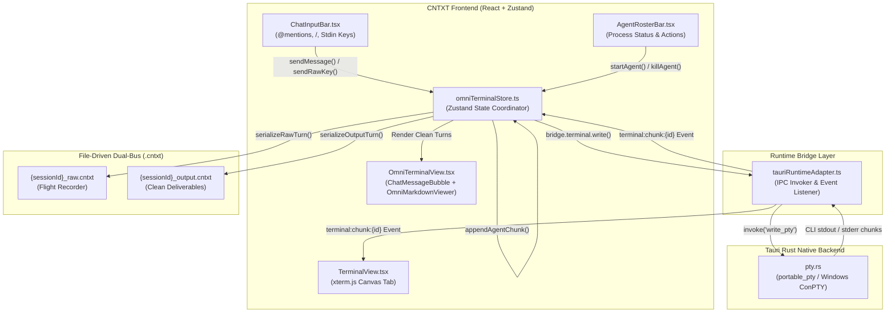
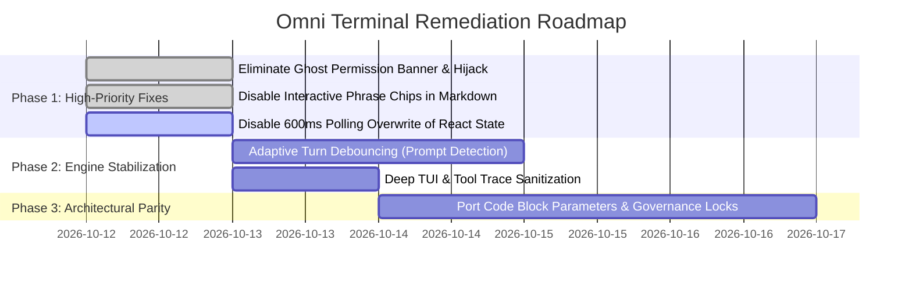

# Omni Terminal: Comprehensive Architecture, Implementation & Friction Report
**Project:** CNTXT (ContextPad)  
**Document Type:** Architectural & Diagnostic Report  
**Date:** 2026-10-12  
**Status:** Living Diagnostic Reference  

---

## 1. Executive Summary & Vision

The **Omni Terminal** is a hybrid multi-agent orchestration console and flight recorder embedded inside CNTXT. It bridges raw, interactive Command-Line Interface (CLI) processes with a clean, high-level AI collaborative chat workspace.

Rather than forcing developers to juggle separate terminal windows (PowerShell, Windows Terminal, VS Code panes) or rely on black-box cloud chat interfaces, Omni Terminal provides:
1. **Multi-Agent Mission Control:** Run, monitor, and direct multiple local CLI agents simultaneously (e.g., Antigravity CLI `@agy`, OpenCode `@opencode`, Cline `@cline`, Kilo `@kilo`, and raw PowerShell `pwsh`).
2. **Dual-Bus File-Driven Persistence:** All agent operations automatically record into two disk files in real time:
   - `_raw.cntxt`: Immutable flight recorder containing verbatim terminal streams, ANSI output, tool traces, and `<thought>` blocks.
   - `_output.cntxt`: Curated, deliverable-focused markdown containing user prompts, final responses, and pinned artifacts.
3. **Hybrid Viewports:** Every agent process can be viewed in two complementary representations:
   - **Chat Feed View:** Clean, formatted GitHub-flavored markdown bubbles for high-level conversation, plans, and answers.
   - **Interactive Terminal Canvas:** Full-featured xterm.js tab inside the central editor surface for real-time keystroke interaction, curses TUIs, and command execution.

---

## 2. Strategic Goals of the Feature

| Goal | Description | Value to Developer |
| :--- | :--- | :--- |
| **Pass 1 / Pass 2 Dual-Agent Workflow** | Enforce independent role separation: Pass 1 Independent Auditor (`@agy`) audits plans and code blindly, while Pass 2 Prod Agent (`@opencode` / `@cline`) implements changes. | Eliminates prompt-drift, confirmation bias, and unauthorized code edits during audit phases. |
| **Zero Data Loss Flight Recording** | Every terminal character and command is appended to disk. | Crashes, terminal restarts, or accidental closures never lose reasoning chains or terminal outputs. |
| **Targeted Routing & Broadcasting** | Type plain prompts to broadcast to all agents, or target specific agents using `@handle` syntax. | Effortlessly delegate tasks (e.g., `@agy audit project` followed by `@opencode fix findings`). |
| **Deliverable Promotion** | 1-click action to copy markdown, pin milestones, or open any agent turn as a dedicated CNTXT document tab. | Seamless transition from terminal discussion into active workspace documentation and editing. |
| **Offline-First Security & Isolation** | Native Rust backend (`portable_pty`) restricted by session tokens, executable sanitization, and canonical directory path checks. | Safe execution of background processes without exposing system-wide shell vulnerabilities. |

---

## 3. How It Works: Technical Architecture & Data Flow

### Component Architecture

1. **Native PTY Engine (`src-tauri/src/commands/pty.rs`):**
   - Uses `portable_pty` to spawn real Windows ConPTY or Unix pseudo-terminals.
   - Sanitizes commands against shell metacharacters and enforces canonical working directories.
   - Streams terminal outputs asynchronously via Tauri event channels (`terminal:chunk:{channelId}`).
2. **Headless State Store (`src/store/omniTerminalStore.ts`):**
   - Maintains active session metadata, pinned agent roster, and chat journal.
   - Debounces incoming PTY stdout streams into conversational agent turns.
   - Detects user prompt echoes to prevent feedback loops.
   - Synchronizes raw and distilled turns directly to disk.
3. **Interactive Presenters (`src/components/OmniTerminal/`):**
   - `OmniTerminalView.tsx`: Main sidebar housing the session title, folder picker, feed, and input bar.
   - `AgentRosterBar.tsx`: Color-coded agent pills displaying real-time process statuses (`idle`, `busy`, `waiting_permission`, `error`, `stopped`).
   - `ChatMessageBubble.tsx`: Renders rich markdown, collapsible `<thought>` trajectory accordions, raw terminal output drawers, and deliverable action buttons (`Copy`, `Open as doc`, `Pin`).
   - `ChatInputBar.tsx`: Keyboard-friendly input bar supporting `@handle` auto-suggest, slash commands (`/audit`, `/test`, `/clear`), and hardware arrow-key delegation.
4. **Formatting & Synchronization Pipeline (`src/features/omniTerminal/format/`):**
   - `omniDocumentSync.ts`: Strips ANSI escape codes, normalizes carriage returns, filters TUI chrome, and serializes turns into standard `.cntxt` frontmatter/comment blocks.
   - `omniPromptDetector.ts`: Analyzes terminal output for confirmation dialogs (`[y/N]`) and interactive selection menus.

---

## 4. Accomplishments & Delivered Milestones

* [x] **Native ConPTY Engine Integration:** Full desktop PTY backend supporting PowerShell, Bash, and complex agent CLIs (`agy`, `cline`, `opencode`).
* [x] **Windows CRLF Command Execution:** Solved conpty line-submission buffer stall by ensuring all terminal inputs submit with `\r\n`.
* [x] **Dual `.cntxt` Document Persistence:** Automatic generation and live appending to `{sessionId}_raw.cntxt` and `{sessionId}_output.cntxt`.
* [x] **Embedded xterm.js Canvas:** Native interactive terminal tabs directly within the central editor surface with automatic window resizing and theme matching.
* [x] **Rich Markdown Chat Viewer (`OmniMarkdownViewer.tsx`):** Renders headings, bold/italics, tables, syntax-highlighted code blocks with 1-click copy, and live Mermaid diagrams without third-party dependencies.
* [x] **Pre-Configured Agent Presets:** Instant 1-click spawning of Antigravity CLI, OpenCode, Cline, Kilo, and raw PowerShell.
* [x] **Testing & Gate Verification:** 620 unit and contract tests passing, 0 TypeScript linter errors, signed Windows portable binaries (`CNTXT_0.5.8_portable.exe`).

---

## 5. Friction Points, Root Cause Analysis & Known Bugs

Despite major structural milestones, user testing in real-world environments revealed 6 core friction points:

### Friction Point 1: Ghost Permission Banner & Input Routing Hijack
* **Symptom:** UI displays `@agy requires attention: [✓ Allow (y)] [Allow Always (a)] [✕ Deny (n)]` even when Antigravity CLI did not prompt for permission. All user messages typed in the chat input bar are redirected exclusively to `@agy`.
* **Root Cause:**
  1. In `omniPromptDetector.ts`, menu detection heuristic misclassified normal agent dialogue (bullet lists, quotes, or navigation hints like `> ↑/↓ Navigate`) as an interactive select menu.
  2. In `omniTerminalStore.ts`, detecting any interactive prompt unconditionally changed agent status to `waiting_permission`.
  3. `ChatInputBar.tsx` hardcoded an `Allow (y) / Allow Always (a) / Deny (n)` banner for any agent in `waiting_permission`.
  4. When an agent was in `waiting_permission`, `ChatInputBar.tsx` routed all messages without an explicit `@handle` strictly to that waiting agent, locking out `@opencode` and broadcast messaging.

### Friction Point 2: Clickable Phrase Chips ("Click to send '...' to process")
* **Symptom:** Hovering over paragraphs, list items, or status summaries inside chat bubbles displayed tooltips like `Click to send "• Inspect or run test verification suites" keypress to process`, rendering every phrase as an interactive button.
* **Root Cause:**
  1. `ChatMessageBubble.tsx` included an "Interactive Option Chips" section intended for TUI radio menus.
  2. `omniPromptDetector.ts` matched any line starting with 2+ spaces, a bullet (`•`), dash (`-`), or pipe (`|`) as an "unselected choice".
  3. A standard markdown response containing 10 bullet points generated 10 interactive terminal keypress buttons.

### Friction Point 3: Chat Disappearing / State Overwriting on Tab Switch
* **Symptom:** Switching between terminal tabs or clicking outside caused the chat feed to reload, flicker, or revert to older snapshot content.
* **Root Cause:**
  1. `omniTerminalStore.ts` ran a background disk-tailing interval every 600ms (`syncFromOutputFile`).
  2. When `_output.cntxt` on disk updated, `set({ messages: parsedTurns })` wiped the entire in-memory chat array and replaced it with whatever was parsed from disk.
  3. Because `_output.cntxt` only contains deliverables and user prompts (omitting real-time streaming turns), active conversations were replaced by incomplete disk snapshots.

### Friction Point 4: Message Truncation During Agent Tool Execution
* **Symptom:** Responses from agents arrived cut in half, or were fragmented into multiple incomplete chat bubbles.
* **Root Cause:**
  1. `appendAgentChunk` relied on a fixed **1200ms debounce timer** to detect when an agent finished speaking.
  2. When an agent ran a tool (e.g., reading a file, searching via ripgrep, or calling an LLM API), no terminal output was emitted for 2–5 seconds.
  3. The 1200ms timer fired prematurely, finalized the partial buffer, and wiped the turn accumulator (`agentTurnBuffers.delete(agentId)`).
  4. When the agent resumed printing, the remainder of the response was either dropped by echo-filtering or created a detached secondary bubble.

### Friction Point 5: OpenCode Echoes User Messages Back
* **Symptom:** Sending a prompt to OpenCode resulted in a chat bubble repeating the user's message without an answer.
* **Root Cause:**
  1. OpenCode runs as a full-screen curses TUI (`OpenCode Zen`) which immediately redraws its screen and echoes the user's input line (`| test`).
  2. While OpenCode started thinking (`+ Thought: 386ms`), the premature 1200ms debounce timer expired.
  3. The buffer at that moment contained only the echoed prompt. The store saved that echo as OpenCode's response.
  4. Meanwhile, because `@agy` was stuck in `waiting_permission`, subsequent user inputs never reached OpenCode's PTY channel.

### Friction Point 6: Residual TUI Chrome Noise
* **Symptom:** Chat bubbles contained terminal artifacts: `> ↑/↓ Navigate • enter Confirm`, `► Ran 2 commands...`, `(ctrl+o to expand)`, and cursor markers.
* **Root Cause:**
  1. `filterTuiChrome` in `omniDocumentSync.ts` filtered specific status bars (like `Big Pickle` and `esc interrupt`) but lacked regex patterns for OpenCode tool traces (`► Ran ...`, `► Explored ...`) and general navigation hints.

---

## 6. Strategic Remediation Plan

### Remediation Action Items:

1. **Remove Heuristic Permission Banners:**
   - Restrict `status: 'waiting_permission'` strictly to unambiguous confirmation lines ending with `[y/N]` or `[Y/n]`.
   - Never hijack user inputs in `ChatInputBar.tsx`—allow users to broadcast or target any agent regardless of another agent's waiting state.
2. **Decommission Clickable Phrase Chips in Chat Bubbles:**
   - Remove choice button generation from standard conversational messages. Render all agent turns strictly as clean Markdown via `OmniMarkdownViewer.tsx`.
3. **Decouple React State from Background File Sync:**
   - Make in-memory `messages` the single source of truth during live sessions.
   - Continue appending turns to `_raw.cntxt` and `_output.cntxt` on disk, but eliminate `syncFromOutputFile` polling that overwrites in-memory state.
4. **Adaptive Agent Turn Completion:**
   - Increase turn timeout threshold to 3000ms, or inspect stream endings for shell prompt returns (`> `, `$ `, `PS >`) to guarantee complete responses before finalizing turns.
5. **Expand TUI Chrome Filter:**
   - Add regex rules in `filterTuiChrome` for navigation hints (`↑/↓ Navigate`), tool traces (`► Ran`, `► Explored`), and curses redraw frames.
