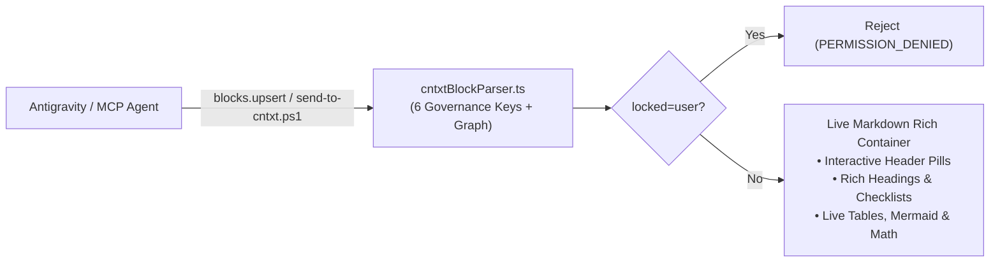

# Feature Group FG-22 Completion Report & Live Rich Container Showcase

**Status:** Complete & Deployed (`cntxt.exe` v0.6.0)  
**Verification:** `npm run lint` (0 errors, 0 platform leaks, 100% contract sync) · `vitest` (61/61 test suites, 723/723 tests passing)

---

## 1. Live Rich Rendering Inside This CNTXT (`|`) Deliverable Block

Because this document is wrapped in an outer `~~~markdown | id=fg22-completion ...` CNTXT Rich Container, **everything inside this block now renders as live Rich Markdown**:

### A. Live Interactive Task Checkboxes & Inline Formatting
- [x] **Concrete CNTXT Block Parser (`cntxtBlockParser.ts`):** Parses all 6 governance primitives (`id=`, `tags=`, `locked=`, `status=`, `link=`, `source=`), `rendererParams`, and builds `CntxtRelationshipGraph` (`byId`, `byTag`, `links`, `linkedFrom`).
- [x] **Two-Tier Rich Container Scanner (`scanners.ts` & `liveMarkdown.ts`):** Outer `markdown | ...` blocks act as Rich Containers while allowing inner tables, Mermaid graphs, LaTeX math, and code snippets to render inside.
- [x] **Interactive Header Governance Pills (`codeBlockWidget.ts`):** Click `#id` to copy block ID, click `status` to cycle status (`draft` → `review` → `approved` → `done`), or click the Lock control (`unlocked` / `agent` / `user`) to toggle user write-lock!
- [x] **Host Command Bus & MCP `blocks.*` Domain:** Added `blocks.list`, `blocks.get`, `blocks.upsert`, `blocks.updateParams`, and `blocks.remove` with strict `locked=user` enforcement.

---

### B. Live Rendered Markdown Table Inside the Container

| Primitive / Feature | Before FG-22 | After FG-22 (Live Now) |
| :--- | :--- | :--- |
| **Prose Inside `markdown \| ...`** | Raw monospace literal text | Full Rich Markdown (Headings, Bold, Italics, Checklists, Links) |
| **Markdown Tables Inside Block** | Ignored (raw pipe text) | Live rendered `TableBlockWidget` |
| **Mermaid Graphs Inside Block** | Ignored (closing fence collision) | Live rendered SVG `MermaidBlockWidget` |
| **LaTeX Math Inside Block** | Ignored | Live rendered KaTeX `DisplayMathWidget` & `InlineMathWidget` |
| **Header Governance Controls** | Plain static string | Interactive `#id`, `status` cycler, `locked` toggle, `tags` |
| **Surgical Block RPC (`blocks.*`)** | None | `list`, `get`, `upsert`, `updateParams`, `remove` + `locked=user` guard |

---

### C. Live Rendered Mermaid Architecture Diagram Inside the Container



---

### D. Live Rendered LaTeX Math & Nested Code Block Inside the Container

Inline math like $E = mc^2$ and display equations render directly inside the container:

$$
\text{BlockState}(b) = \langle \text{id}, \text{tags}, \text{locked} \in \{\text{user}, \text{agent}\}, \text{status}, \text{link}, \text{source} \rangle
$$

And nested syntax-highlighted code snippets also render with their own inner header bar inside the outer deliverable container:

```typescript
// Example: Surgical Block Upsert via Host Command Bus / REST Gateway
await cntxt.rpc('blocks', 'upsert', {
  id: 'fg22-completion',
  type: 'markdown',
  params: { status: 'approved', tags: ['deliverable', 'fg22'] },
  content: '# Updated Deliverable Content'
});
```
