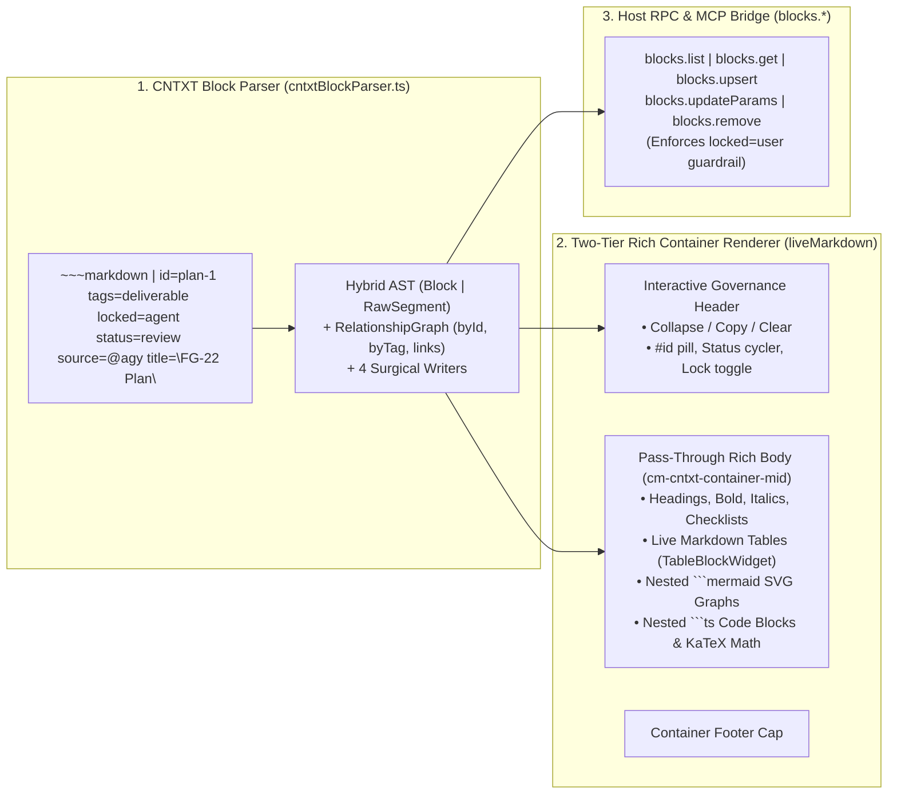

# Feature Group FG-22 Implementation Plan: CNTXT Block Parser Engine, Rich Container Rendering & Surgical Block RPC (`blocks.*`)

**Project:** CNTXT (`C:\Projects\LocalActive\Repo\Active\cntxt`)  
**Feature Group:** FG-22 — CNTXT Pipe (`|`) Block Parser, Rich Container Editor Rendering & Surgical Block Orchestration RPC  
**Date:** 2026-10-21  
**Status:** Ready for Review & Execution  

---

## 1. Objective & Architectural Problem Statement

In CNTXT, fenced code blocks with a pipe (`|`) in their info string (`language | params`) are **CNTXT-owned Stateful Blocks (`isCNTXT: true`)**. Currently, the desktop editor only splits on `|` to show raw text in the header badge (`extraParam`) while treating the block's body as a raw literal monospace code snippet. This causes three major limitations for agentic orchestration:

1. **No Rich Text Rendering Inside CNTXT Blocks:** Even in Live Render Mode, prose inside a `~~~markdown | ...` block is forced into monospace (`cm-live-codeblock-mid`) and skips all inline/block Markdown formatting (headings, bold/italics, task checkboxes, blockquotes, links).
2. **Mermaid Diagrams, Markdown Tables & LaTeX Math Inside CNTXT Blocks Are Blinded:** `findCodeBlocks()` marks all lines inside an outer fence as `codeBlocksByLine`, causing `findTables()`, `findMathBlocks()`, and nested ```` ```mermaid ```` / ```` ```ts ```` blocks inside a deliverable to be completely ignored.
3. **No Concrete Governance Parser or Surgical Block RPC:** The 6 governance primitives (`id=`, `tags=`, `locked=`, `status=`, `link=`, `source=`), the relationship graph (`byId`, `byTag`, `links`), and the 4 surgical block writers (`updateBlockParams`, `updateBlockContent`, `insertBlock`, `removeBlock`) from `06-parser-production-code.ts` are not yet integrated into the desktop editor, Outline Panel, Host RPC Bus, or MCP bridge.

### How FG-22 Solves All Three:


---

## 2. Canonical Contract Changes (`contracts/data_shapes.ts` & `src/contracts/boundarySchemas.ts`)

1. **CNTXT Block AST & Governance Interfaces (`contracts/data_shapes.ts`):**
   - `CntxtLockValue = 'agent' | 'user'`
   - `CntxtBlockParams`:
     - `id?: string`
     - `tags?: string[]`
     - `locked?: CntxtLockValue`
     - `status?: string`
     - `link?: string[]`
     - `source?: string`
     - `label?: string` *(human display title from `title="..."` or freeform text after `|`)*
     - `rendererParams?: Record<string, string>`
   - `CntxtParsedBlock`:
     - `type: string`
     - `fence: string` *(preserves exact ```` ``` ```` or `~~~` fence length)*
     - `params: CntxtBlockParams`
     - `content: string`
     - `position: { start: number; end: number; startLine: number; endLine: number }`
     - `isCNTXT: boolean`
     - `isRichContainer: boolean`
   - `CntxtRawSegment`, `CntxtRelationshipGraph`, `CntxtParsedDocument`
2. **Host RPC Domain Addition (`blocks`):**
   - Add `'blocks'` to `CntxtRpcDomain` in `contracts/data_shapes.ts` and `src/contracts/boundarySchemas.ts`.
   - Add Zod schemas for:
     - `blocks.list` (`{ tabId?: string; tag?: string; status?: string; onlyCntxt?: boolean }`)
     - `blocks.get` (`{ id: string; tabId?: string }`)
     - `blocks.upsert` (`{ id: string; type?: string; content: string; params?: Partial<CntxtBlockParams>; afterBlockId?: string; tabId?: string }`)
     - `blocks.updateParams` (`{ id: string; params: Partial<CntxtBlockParams>; tabId?: string }`)
     - `blocks.remove` (`{ id: string; tabId?: string }`)
   - Sync all 3 contract mirror files (`contracts/data_shapes.ts`, `src/contracts/data_shapes.ts`, `generated-documents/context/contracts/data_shapes.ts`).

---

## 3. Concrete Parser & Surgical Writer (`src/services/editor/cntxtBlockParser.ts`)

Port and upgrade `06-parser-production-code.ts` into `src/services/editor/cntxtBlockParser.ts`:
1. **Variable-Length Fence Support:**
   - Supports ```` ``` ````, ```` ```` ````, `~~~`, `~~~~` fences so outer `~~~markdown | ...` blocks containing nested ```` ```mermaid ```` or ```` ```ts ```` fences never close prematurely.
   - Automatically computes a collision-free fence (`computeSafeFence(content, preferredChar)`) when serializing or updating block content.
2. **Governance + Shorthand Info String Parser (`parseBlockInfoString(infoString)`):**
   - Extracts `type` (before `|`) and parses everything after `|`:
     - Structured `key=value`, `key="quoted"`, `key='quoted'` pairs populate the 6 governance keys (`id`, `tags`, `locked`, `status`, `link`, `source`) and `rendererParams`.
     - If `rendererParams.title` is provided, sets `params.label = rendererParams.title`.
     - Any remaining unkeyed tokens after `|` (e.g., `@agy · FG-21 Plan`) are preserved as `params.label` for backward compatibility with existing blocks.
3. **Rich Container Classification (`isRichContainerType(type, isCNTXT)`):**
   - Returns `true` when `isCNTXT === true` and `type` is in `['markdown', 'md', 'cntxt', 'deliverable', 'agent', 'text', '']`.
   - Returns `false` for programming languages (`typescript`, `rust`, `json`, `yaml`, `python`, etc.), which keep standard syntax-highlighted code block rendering while still getting CNTXT governance header pills if `|` is present!
4. **Relationship Graph & 5 Surgical Writer Functions:**
   - `parseCntxtDocument(raw: string): CntxtParsedDocument`
   - `updateBlockParams(doc, blockId, newParams): string`
   - `updateBlockContent(doc, blockId, newContent): string`
   - `insertBlock(doc, block, afterBlockId?): string`
   - `removeBlock(doc, blockId): string`
   - `upsertBlock(doc, block, afterBlockId?): { content: string; action: 'inserted' | 'updated' }`

---

## 4. Two-Tier Rich Container Scanner & Editor Rendering (`src/extensions/liveMarkdown/`)

### A. Two-Tier Scanner (`src/extensions/liveMarkdown/scanners.ts`)
1. Add `findCntxtContainers(doc: Text): Map<number, CntxtContainerLineEntry>`:
   - Scans for outer fenced blocks where `isRichContainer === true` (`~~~markdown | ...`, ```` ```markdown | ... ````, etc.).
   - Records `role: 'start' | 'mid' | 'end' | 'single'` for the outer container in `cntxtContainersByLine`.
2. Update `findCodeBlocks(doc: Text, cntxtContainersByLine?)`:
   - Ignores the `start` and `end` fence lines of outer `cntxtContainersByLine` so it **scans inside** the Rich Container!
   - Any nested ```` ```mermaid ````, ```` ```latex ````, or ```` ```typescript ```` block inside the Rich Container is captured in `codeBlocksByLine`!
3. `findMathBlocks` and `findTables`:
   - Because they check `codeBlocksByLine` (plus skip container `start`/`end` fence lines), **every Markdown table (`| A | B |`) and display math block (`$$ ... $$`) inside a CNTXT Rich Container is automatically detected and rendered!**

### B. Pass-Through Rich Rendering (`src/extensions/liveMarkdown.ts`)
In `buildDecorations(state)`:
1. **Check `cntxtContainersByLine.get(line.number)` FIRST:**
   - **If `role === 'start'`:**
     - If `isLineActive`: render raw fence line with `.cm-cntxt-container-start.cm-live-active-row` so you can edit the `| id=...` parameters directly if desired.
     - If `isCollapsed && !isContainerActive`: render `CodeBlockHeaderWidget` (collapsed) on `startLine` and `Decoration.replace({ block: true })` from `startLine.to` to `endLine.to` — collapsing the entire container (including inner tables/Mermaid) into one header bar!
     - If expanded: render `CodeBlockHeaderWidget` (expanded, rich container mode) on `startLine`, then `pos = line.to + 1; continue;`.
   - **If `role === 'end'`:**
     - If `isLineActive`: render `.cm-cntxt-container-end.cm-live-active-row`.
     - Otherwise: replace `endLine` with `CodeBlockFooterWidget(true)` and `continue;`.
   - **If `role === 'mid'`:**
     - **DO NOT `continue;`!**
     - Set `inCntxtContainer = true` for this line.
     - Fall right through to **Section A (inner `codeBlocksByLine` — Mermaid, Math, nested code snippets)**, **Section B (`mathBlocksByLine`)**, **Section C (`tableBlocksByLine`)**, and **Section D (Regular Markdown Row — Headings `# H1..H6`, Blockquotes, Task Checkboxes, Lists, Inline Math, Images, Links, Bold/Italic)**.
     - In Section D (and active inner rows), append `cm-cntxt-container-mid` (and `cm-cntxt-locked-user` / `cm-cntxt-locked-agent` modifier class) to the line decoration so the entire container has a cohesive visual card frame and left accent stripe while rendering 100% rich prose, tables, and Mermaid diagrams inside!

### C. Interactive Governance Pills in `CodeBlockHeaderWidget` (`src/extensions/liveMarkdown/widgets/codeBlockWidget.ts`)
When `parsedInfo.isCNTXT` is `true`:
- Render structured pills in the header bar:
  1. **Type / Source Badge:** Shows `params.source` (e.g., `@agy`) or language badge.
  2. **Title / Label:** Shows `params.label` (`title="..."` or shorthand text) in clean semibold UI font.
  3. **`#id` Badge:** Monospace `#id` pill (`id=`) — clicking copies the block ID.
  4. **Interactive `status=` Pill:** Colored status badge (`draft`, `review`, `active`, `approved`, `done`) — clicking cycles the block's `status=` parameter directly in the document!
  5. **Interactive `locked=` Toggle Button:** Shows `🔓` (unlocked), `🤖 agent` (`locked=agent`), or `🔒 user` (`locked=user`). Clicking toggles `locked=user` in the opening fence line so you can freeze/unfreeze any block against agent overwrites with a single click!
  6. **Tag Chips:** Renders up to 3 compact `#tag` pills from `params.tags`.
  7. **Clear & Copy Buttons:** When `locked=user`, the Clear button shows a lock tooltip and prevents accidental clearing until unlocked.

---

## 5. Host Command Bus (`blocks.*`), Outline Panel & MCP Bridge

1. **`src/features/panelApps/rpc/hostCommandBus.ts` (`handleBlocksDomain`):**
   - `blocks.list`: Parses the target tab (or active tab) with `parseCntxtDocument()` and returns all blocks (filtered by `tag`, `status`, or `onlyCntxt`).
   - `blocks.get`: Looks up `doc.relationshipGraph.byId[id]` and returns the block + its `links` and `linkedFrom`.
   - `blocks.upsert`:
     - Checks if `id` exists in `doc.relationshipGraph.byId`.
     - **Guardrail:** If existing block has `params.locked === 'user'`, rejects with `PERMISSION_DENIED: Block "<id>" is locked by user and cannot be overwritten by an agent.`
     - Updates block in place (`updateBlockContent` + `updateBlockParams`) or inserts a new block (`insertBlock`), updates the tab content, and saves to disk if the tab has a `filePath`.
   - `blocks.updateParams`: Updates governance parameters (`status`, `locked`, `tags`, `link`, `source`) on block `id` (respecting `locked === 'user'` unless explicitly unlocked).
   - `blocks.remove`: Removes block `id` (rejecting if `locked === 'user'`).
2. **`src/components/Sidebar/OutlinePanel.tsx`:**
   - Upgrade code block detection to support both ```` ``` ```` and `~~~` fences, and display CNTXT blocks with their `#id`, `label`/`title`, and `status` in the Outline tree.
3. **`scripts/mcp/cntxt-mcp-server.mjs` & `C:\Projects\LocalActive\scripts\send-to-cntxt.ps1`:**
   - Update `send-to-cntxt.ps1` to emit canonical CNTXT governance headers:
     `~~~markdown | id=<slug> tags=deliverable locked=agent status=ready source=@agy title="<Title> (<HH:mm>)"`
   - Add `cntxt_list_blocks`, `cntxt_get_block`, `cntxt_upsert_block`, and `cntxt_update_block_params` tools to `cntxt-mcp-server.mjs`.

---

## 6. Verification & Testing Matrix

1. **Unit & Integration Tests (`tests/cntxtBlockParser.test.ts` & `tests/liveMarkdownRichContainer.test.ts`):**
   - Verify `parseCntxtDocument` extracts all 6 governance primitives (`id`, `tags`, `locked`, `status`, `link`, `source`), `rendererParams`, `label`, and builds `relationshipGraph` (`byId`, `byTag`, `links`, `linkedFrom`).
   - Verify variable-length fences (`~~~markdown | id=outer` containing inner ```` ```mermaid ```` and ```` ```ts ````) parse as a single outer block without premature closing.
   - Verify all 4 surgical writers (`updateBlockParams`, `updateBlockContent`, `insertBlock`, `removeBlock`) preserve surrounding Markdown and auto-upgrade fences if inner triple-backticks are present.
   - Verify `findCntxtContainers`, `findCodeBlocks`, `findTables`, and `findMathBlocks` detect **Markdown tables**, **LaTeX math**, and **nested Mermaid code blocks** inside a `~~~markdown | id=...` Rich Container.
   - Verify `HostCommandBus` `blocks.upsert` and `blocks.remove` succeed on unlocked/`locked=agent` blocks and reject with `PERMISSION_DENIED` when `locked=user`.
2. **Quality Gates:**
   - `npm run lint` (`0` errors, `100%` contract sync across all 3 `data_shapes.ts` copies).
   - `npx vitest run` (`100%` test suites passing).
   - Production Tauri release build (`cntxt.exe`) deployed and live-tested with a Rich Container deliverable containing headings, task checkboxes, a Markdown table, and a Mermaid diagram.
