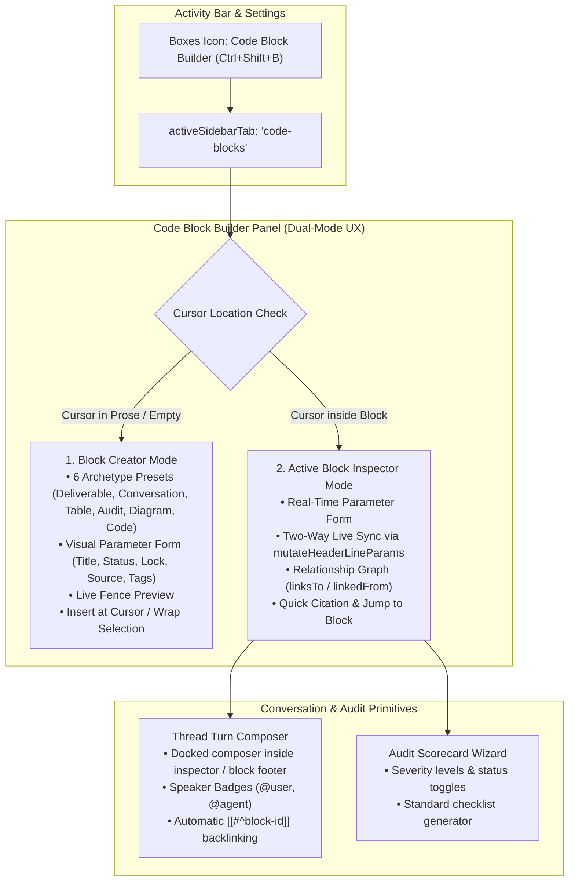

# Feature Group FG-26 Implementation Plan: Code Block Builder Rail Panel & First-Class Block Primitives Overhaul

**Project:** CNTXT (`C:\Projects\LocalActive\Repo\Active\cntxt`)  
**Feature Group:** FG-26 — Code Block Builder Rail Panel, Active Block Inspector & Conversation Thread Overhaul  
**Date:** 2026-11-07  
**Author:** Prod Agent (`prod_agent`)  
**Status:** Ready for Review & Implementation  

---

## 1. Objective & Architectural Problem Statement

In CNTXT, fenced code blocks with governance attributes (`language | id=... locked=... status=...`) and specialized syntax (`~~~markdown`, `~~~table`, `~~~conversation`, ````mermaid````) are foundational to AI pair-programming, agentic deliverables, and structured human-AI collaboration.

However, the current user experience has three major usability frictions:
1. **High Cognitive Load for Block Syntax:** Users and human reviewers must memorize or manually type fence characters (`~~~` vs ```` ````), pipe delimiters (`|`), and key-value pairs (`id=`, `tags=`, `locked=`, `status=`, `source=`, `title=`). A single typographical error degrades the block to a plain monospace snippet.
2. **Disconnected Block Editing:** Inspecting or changing an existing block's governance metadata (e.g. promoting a draft to `status=ready` or locking a section as `locked=user`) requires manual cursor navigation to the header line or clicking tiny cycle badges, with zero visual overview of the block's parameters, relationships, or citations.
3. **Fragmented Thread Conversation UX:** The current inline comment popover (`openCntxtReplyInputEffect`) floats over document lines, can drift during scrolling or window resizing, and appends raw citations to a disconnected `#user-inbox` block at the bottom of the document rather than offering a cohesive, contextual conversation flow.

### Architectural Solution: Code Block Builder as a First-Class Rail Panel


---

## 2. Scope Boundaries & Non-Goals (Pillar 6 Enforcement)

### Authorized In-Scope Deliverables
1. **Activity Bar & Sidebar Rail Integration:**
   - Add `'code-blocks'` to `ViewSettings['activeSidebarTab']` in `src/types.ts` and `src/contracts/boundarySchemas.ts`.
   - Register dedicated Activity Bar button with Lucide `Boxes` icon in `src/components/Sidebar/ActivityBar.tsx`.
   - Implement `CodeBlockBuilderPanel.tsx` in `src/components/Sidebar/`.
2. **Block Archetype Catalog & Presets:**
   - 6 Archetypes: Deliverable (Rich Container), Conversation Thread, Interactive Table, Audit Scorecard, Mermaid Diagram, Code Snippet/Action.
   - Presets with safe fence computation (`computeSafeFence`) preventing premature closing on nested fences.
3. **Cursor Observer & Active Block Tracking:**
   - Lightweight, zero-polling CodeMirror cursor listener dispatching active block coordinates (`startLine`, `endLine`, `params`, `type`, `id`) to `activeBlockStore.ts`.
4. **Bidirectional Block Inspector:**
   - Live visual synchronization: changing dropdowns, status pills, or text in the rail panel surgically mutates the document header line using `mutateHeaderLineParams` without clobbering text or losing undo history.
5. **Thread Conversation Overhaul:**
   - First-class `~~~conversation` block styling with alternating speaker cards (`@user` vs `@agent`), clean timestamps, and docked turn composer.
6. **Unit & Regression Test Coverage:**
   - Comprehensive tests for catalog generation, parameter serialization, cursor detection, two-way header mutations, and conversation thread generation.

### Strict Non-Goals (Scope Creep Guardrails)
- **NO Cloud Sync / External API dependencies:** All presets, builder controls, and inspectors operate 100% locally and offline.
- **NO LLM Generation inside Panel:** The Code Block Builder is a deterministic visual authoring tool; it does not call external LLMs or OpenAI/Anthropic APIs.
- **NO Monolithic God-Objects:** The UI is partitioned into pure Presenter components (`CodeBlockBuilderPanel`, `ArchetypeSelector`, `BlockParamForm`, `ActiveBlockInspector`, `ThreadComposerPresenter`) and headless Zustand stores.

---

## 3. Canonical Contract Changes (`contracts/data_shapes.ts`)

Add the following domain models to `contracts/data_shapes.ts` (and mirror across `src/contracts/data_shapes.ts` and `generated-documents/context/contracts/data_shapes.ts`):

```ts
// ==========================================
// 18. Code Block Builder & Archetypes (FG-26)
// ==========================================

export type CntxtBlockArchetype =
  | 'deliverable'
  | 'conversation'
  | 'table'
  | 'audit'
  | 'diagram'
  | 'code';

export interface CntxtBlockPreset {
  id: string;
  name: string;
  archetype: CntxtBlockArchetype;
  language: string;
  description: string;
  icon: string;
  defaultParams: Partial<CntxtBlockParams>;
  defaultContent: string;
  preferredFence?: '~~~' | '```';
}

export interface ActiveBlockCursorState {
  isInsideBlock: boolean;
  block: CntxtParsedBlock | null;
  tabId: string | null;
  cursorLine: number;
}
```

Update `ViewSettings`:
```ts
export interface ViewSettings {
  // ...
  activeSidebarTab: 'explorer' | 'outline' | 'templates' | 'actions' | 'code-blocks' | 'app-builder' | 'panel-app' | 'settings';
}
```

---

## 4. Architectural Invariants Compliance

| Pillar | Requirement | Implementation Strategy |
| :--- | :--- | :--- |
| **Pillar 1: Mock Quarantine** | Zero inline mocks | Presets are defined as factory templates under `TR-017`; collections initialize empty (`[]`). Zero synthetic mocks in `/src/`. |
| **Pillar 2: Presenter Purity & Tokens** | Pure UI, zero IPC loops, CSS tokens | `CodeBlockBuilderPanel` receives props and store selectors; consumes CSS theme variables (`var(--accent-primary)`, `var(--card-bg)`, `var(--border-subtle)`). |
| **Pillar 3: Type Strictness** | Zero `any` | Fully typed interfaces, strict Zod boundary validation. |
| **Pillar 4: Modularity & Extensibility** | Dynamic registration APIs | Archetypes and presets registered via extensible dictionary (`registerBlockArchetype`, `registerBlockPreset`). |
| **Pillar 6: Scope Enforcement** | Aligned with Brief | Confined strictly to Code Block Builder, Inspector, and Conversation UX. |
| **Pillar 7: Background Processes** | Zero autonomous background workers | Event-driven architecture; updates trigger strictly from CodeMirror cursor/selection events and user form input. |
| **Pillar 8: Security & Sandboxing** | Path and shell metacharacter safety | Param serialization escapes quotes; block mutations respect `locked=user` guardrail. |
| **Pillar 9: Validation & Resilient Errors** | Zod validation & toasts | All block parameters validated against `BoundarySchemas`; errors dispatch toasts via `useNotificationStore`. |
| **Pillar 10: Performance & Economy** | Debounced cursor updates | Cursor block lookup is $O(B)$ where $B$ is the number of code blocks in the document (typically $< 50$); debounced on high-frequency typing. |

---

## 5. Detailed Step-by-Step Implementation Roadmap

```
Step 1: Canonical Contracts & Schema Synchronization
  ├── Update contracts/data_shapes.ts with CntxtBlockArchetype, CntxtBlockPreset, ActiveBlockCursorState
  ├── Update src/contracts/boundarySchemas.ts (ViewSettingsSchema)
  └── Sync mirror contracts and run npm run lint to verify zero leaks

Step 2: Headless State & Cursor Observer
  ├── Author src/store/activeBlockStore.ts (manages activeBlock, cursorLine, isInsideBlock, manual override)
  └── Connect CodeMirror editor transaction listener in src/shell/ShellEditorContainer.tsx to notify activeBlockStore

Step 3: Block Archetypes & Preset Catalog Service
  ├── Author src/services/editor/blockPresetCatalog.ts (default presets for Deliverable, Conversation, Table, Audit, Diagram, Code)
  └── Author safe fence generator helper wrapping computeSafeFence

Step 4: Presenter Components for Code Block Builder
  ├── Author src/components/CodeBlockBuilder/ArchetypePicker.tsx (Grid/Pill selector for the 6 archetypes)
  ├── Author src/components/CodeBlockBuilder/BlockParamForm.tsx (Title, Status, Lock, Source, Tags inputs)
  ├── Author src/components/CodeBlockBuilder/ActiveBlockInspector.tsx (Two-way live editor sync & citation graph)
  └── Author src/components/CodeBlockBuilder/ThreadComposerPresenter.tsx (Docked thread reply composer)

Step 5: Sidebar Rail Integration
  ├── Update src/components/Sidebar/ActivityBar.tsx (add Boxes icon button for 'code-blocks')
  ├── Update src/components/Sidebar/Sidebar.tsx (render CodeBlockBuilderPanel)
  └── Add keyboard shortcut (Ctrl+Shift+B) in CommandPalette and global keybindings

Step 6: Enhanced Conversation & Audit Primitives
  ├── Upgrade src/extensions/liveMarkdown/widgets/codeBlockWidget.ts (cleaner conversation turn styling)
  └── Add 1-click citation helper ([[#^block-id]]) between inspector and editor

Step 7: Automated Test Suite & Multi-Pillar Verification
  ├── Author tests/codeBlockBuilder.test.ts (preset resolution, parameter mutation, boundary validation)
  ├── Author tests/activeBlockStore.test.ts (cursor entry/exit, two-way sync, locked=user protection)
  ├── Run npm run lint (0 errors)
  ├── Run npm test (all suites green)
  ├── Run cargo test --lib (clean)
  └── Run localactive_scan.mjs (P3 = 0, zero any)
```

---

## 6. Verification Criteria & Verification Harness

1. **Lint & Contracts:** `npm run lint` exits with code 0; contracts in sync; 0 platform leaks outside authorized adapters.
2. **Unit Tests:** `npm test` passes with 100% green tests; new tests in `tests/codeBlockBuilder.test.ts` pass.
3. **Rust Suite:** `cargo test --lib` passes with 15/15 green tests.
4. **Deterministic Scanner:** `node scripts/verification/localactive_scan.mjs` verifies 0 Pillar 3 violations (zero `any` in production code).
5. **Interactive UI Verification:**
   - Opening CNTXT displays the new Code Block Builder icon in the Activity Bar.
   - Clicking an archetype (e.g. "Deliverable") and typing a title allows 1-click insertion into the editor.
   - Placing the cursor inside an existing block automatically displays the block's parameters in the Inspector.
   - Changing the status dropdown in the Inspector instantly updates the block's header line in the editor document.
